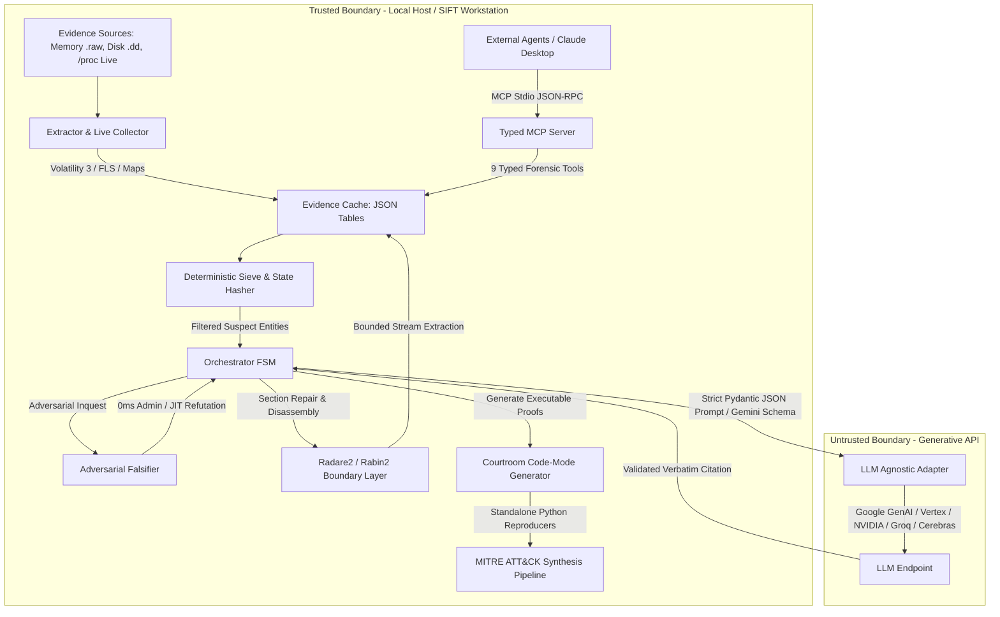

# Project Mantis: Autonomous DFIR Framework

[](https://github.com/codebyangelo/project-mantis/actions/workflows/test.yml)

Project Mantis is an autonomous Digital Forensics and Incident Response (DFIR) framework designed to ingest raw memory and disk images, extract artifacts using SIFT Workstation tools and live `/proc` interfaces, and perform deterministic, hallucination-free triage using an LLM Agnostic Provider architecture.

> [!NOTE]
> **Hackathon Provenance & Historical Archive:**
> The original SIFT/SANS Hackathon submission (`v0.5.2`) and all iterative hackathon prototypes (`v0.0.1` through `v0.5.1`) are permanently preserved in Git history and archived on branch [`archive/hackathon-v0.5.2`](https://github.com/codebyangelo/project-mantis/tree/archive/hackathon-v0.5.2) and Git tag [`hackathon-archive-v0.5.2`](https://github.com/codebyangelo/project-mantis/releases/tag/hackathon-archive-v0.5.2).
> 
> The `main` branch contains the production package (`src/mantis/`) featuring upstream Radare2 memory boundary hardening, an Adversarial Falsification engine, Courtroom Code-Mode proof synthesis, a unified CLI, and a typed Model Context Protocol (MCP) server.

---

## 🏛️ System Architecture

Mantis enforces a hard trust boundary between local deterministic extraction and external generative inference:



Detailed architectural specifications are located in [`docs/ARCHITECTURE.md`](docs/ARCHITECTURE.md) and module documentation in [`docs/subsystems/`](docs/subsystems/).

---

## ⚙️ Core Architectural Invariants

1. **The Citation Trap (Hard Grounding Layer):**
   To eliminate hallucinated evidence, Mantis forces all LLM providers through strict Pydantic schemas requiring character-for-character verbatim telemetry quotes (`exact_telemetry_quote`). The orchestrator programmatically verifies quotes against raw evidence cache files (`verify_grounding`). Any claim failing exact substring verification is automatically tagged `GROUNDING_VIOLATION` and downgraded.
2. **Deterministic Pre-Filtering (Assembly & Path Sieve):**
   Before consuming LLM API calls, memory allocations and process structures pass through zero-latency local regex and assembly trampolines (`sieve_deterministic.py`). Redirections (`movabs rax, <addr>; jmp rax`), ROP stubs (`push <addr>; ret`), and known JIT engine protections are classified in 0ms locally.
3. **Adversarial Falsifier & Challenger Inquest (Inspired by Mulder):**
   Prior to finalizing malicious verdicts, an adversarial counter-inquest searches for contradictory benign explanations. Routine administrative maintenance tasks (`logrotate`, `cron`, `anacron`) and JIT runtimes (`node`, `java`, `dotnet`) are cleared deterministically at 0ms latency without consuming external API quota.
4. **Upstream Radare2 Boundary Hardening:**
   Forensic memory dumps and disk images are treated as untrusted inputs. Mantis injects upstream Radare2 security invariants:
   - **Radare2 PR #26606:** Pre-parsing partition and sector bounds (`validate_sector_bounds`) with fail-closed validation before disk seeks.
   - **Radare2 Issue #12924:** Enforcing a strict 64KB heap ceiling (`ClampedStreamReader`) to prevent memory starvation attacks.
   - **Pre-Return Cache Flushing:** Immediate cache invalidation (`invalidate_evidence_cache`) upon read failures to prevent persistent cache poisoning.
5. **Courtroom Code-Mode (Inspired by Camel):**
   Natural-language LLM output is inadmissible hearsay in judicial proceedings. Mantis generates standalone, zero-dependency Python reproduction scripts embedded directly in Section 8 of the MITRE incident report. Scripts verify SHA-256 evidence integrity and extract byte-exact proof with deterministic exit codes in under 50ms.
6. **State Hashing & Deduplication:**
   Candidate entities are fingerprinted via deterministic SHA-256 hashes (`get_state_hash`) covering stable telemetry fields. Unchanged entities across sliding inspection windows bypass redundant LLM re-evaluations.
7. **Presumption of Benignity (Baseline Subtraction):**
   Ingests [`baseline_kb.json`](src/mantis/baseline_kb.json) to suppress false positives on known-good administrative binaries (`svchost.exe`, `sshd`, `systemd`) and RFC1918 internal subnets, reserving LLM budget for genuinely anomalous telemetry.
8. **In-Engine Surgical Memory Carving:**
   Provides custom Volatility 3 plugins ([`MantisLinuxCarve`](src/mantis/mantis_carve.py) and [`MantisWindowsCarve`](src/mantis/mantis_carve.py)) that execute targeted regex sweeps inside target PID VAD allocations directly within Volatility address spaces.

---

## 🚀 Installation & Setup

### 1. Prerequisites
* **OS:** Linux (SIFT Workstation, Ubuntu 22.04+, Debian 12+, or Termux/Android Linux)
* **Python:** Python 3.10+
* **Forensic Toolchains (Offline Mode):** Volatility 3, The Sleuth Kit (`fls`, `icat`), and Radare2 (`r2`, `rabin2`, `rahash2`)

### 2. Install Package
Install in editable mode:
```bash
git clone https://github.com/codebyangelo/project-mantis.git
cd project-mantis
pip install -e .
```

### 3. Verification Suite
Execute the comprehensive automated test matrix (**70 unit tests**):
```bash
python3 -m unittest discover tests
```

---

## 💻 CLI & Operation Modes

Mantis provides the unified `mantis` command-line executable:

### 1. Forensic Triage (`mantis triage`)
Runs offline disk/memory triage or live continuous host monitoring:

```bash
# Standard exhaustive offline triage across memory and disk images
mantis triage

# Deep triage mode (enables EVTX, Registry hives, Prefetch, and LNK extraction)
mantis triage --deep

# Live Linux host monitoring with 30-second sliding inspection windows
mantis triage --live --interval 30

# Backwards-compatible legacy invocation flags
mantis --deep
mantis --live
```

### 2. Evidence Carving (`mantis carve`)
Directly runs the forensic extraction and carving engine across memory and disk images:

```bash
# Run all standard extractors
mantis carve

# Selective extraction
mantis carve --memory
mantis carve --disk --registry
mantis carve --evtx --pcap --deep
```

### 3. Standalone Memory Dump Analysis (`mantis analyze-dump`)
Evaluates raw memory dumps or carved allocations using deterministic assembly classification and adversarial false-positive refutation:

```bash
# Human-readable console analysis
mantis analyze-dump /path/to/dump.raw --pid 1000

# Structured machine-readable JSON output
mantis analyze-dump /path/to/dump.raw --pid 1000 --json
```

### 4. Model Context Protocol Server (`mantis mcp`)
Launches the built-in stdio JSON-RPC 2.0 MCP server, exposing 9 typed forensic and reverse-engineering tools:

```bash
mantis mcp
```

**Claude Desktop Configuration (`claude_desktop_config.json`):**
```json
{
  "mcpServers": {
    "project-mantis": {
      "command": "mantis",
      "args": ["mcp"],
      "env": {
        "GEMINI_API_KEY": "your-api-key"
      }
    }
  }
}
```

---

## 🔧 Environment Configuration

All runtime configurations are managed via environment variables:

| Variable | Default | Description |
| :--- | :--- | :--- |
| `PM_EVIDENCE_DIR` | Auto-detected (`~/.cache/mantis/evidence` or `/sdcard/Download/evidence`) | Directory containing raw disk (`.dd`, `.raw`) and memory images. |
| `PM_CACHE_DIR` | `$PM_EVIDENCE_DIR/evidence_cache` | Output path for normalized forensic JSON tables. |
| `PM_LLM_PROVIDER` | `gemini_free` | Inference adapter: `gemini_free`, `vertex`, `nvidia`, `groq`, `cerebras`, or `mock`. |
| `PM_PLAYBOOK_PATH` | Dynamic | Path to DFIR playbook (auto-selects Linux vs Windows playbook). |
| `GEMINI_API_KEY` | None | API key for Google GenAI / Gemini Free endpoints. |
| `VERTEX_PROJECT_ID`| None | Google Cloud Project ID for enterprise Vertex AI inference. |
| `VERTEX_LOCATION`  | `us-central1` | Regional location for Vertex AI endpoint. |
| `NVIDIA_API_KEY`   | None | API key for NVIDIA NIM inference adapter. |
| `GROQ_API_KEY`     | None | API key for Groq fast LPU inference. |
| `CEREBRAS_API_KEY` | None | API key for Cerebras inference adapter. |

---

## 📂 Repository Structure

```
project-mantis/
├── pyproject.toml              # Modern build system & CLI configuration
├── requirements.txt            # Locked dependencies
├── src/
│   └── mantis/                 # Core engine package (v0.5.5)
│       ├── __init__.py         # Public API exports
│       ├── cli.py              # Unified CLI (triage, carve, analyze-dump, mcp)
│       ├── agent.py            # Gemini Structured Output & Provider Adapters
│       ├── baseline_engine.py  # RFC1918 & Known-Good Baseline Engine
│       ├── baseline_kb.json    # Baseline Knowledge Base
│       ├── config.py           # Resilient path resolution (Linux ~/.cache vs Termux /sdcard)
│       ├── courtroom.py        # Courtroom Code-Mode standalone Python script generator
│       ├── dfir_playbook.json  # Windows DFIR State Machine Playbook
│       ├── dfir_playbook_linux.json # Linux DFIR State Machine Playbook
│       ├── exceptions.py       # Fail-closed domain exception hierarchy
│       ├── extractor.py        # Volatility 3 & SleuthKit extractor with 64KB heap ceiling
│       ├── falsifier.py        # Adversarial Falsifier with 0ms admin/JIT pre-filtering
│       ├── live_collector.py   # Pure-Python live Linux artifact extractor
│       ├── logger.py           # Structured execution logger
│       ├── mantis_carve.py     # Custom Volatility 3 VAD surgical carving plugins
│       ├── mcp_server.py       # Low-level forensic tool invocation boundaries
│       ├── mcp/                # Typed Model Context Protocol subsystem
│       │   ├── __init__.py     # MCP exports and convenience launchers
│       │   ├── server.py       # Stdio JSON-RPC 2.0 protocol server
│       │   └── tools.py        # 9 typed tools with parameter schemas & path validation
│       ├── orchestrator.py     # Orchestrator FSM loop with SHA-256 state hashing
│       ├── r2/                 # Isolated Radare2 reverse-engineering subsystem
│       │   ├── __init__.py     # r2 subsystem exports
│       │   ├── parser.py       # Typed JSON parser for rabin2/r2/rahash2
│       │   ├── reconstructor.py# Binary section repair (radare2 Issue #15449)
│       │   └── wrapper.py      # Process supervisor with ~/.cache/mantis/r2_libs isolation
│       ├── sieve.py            # Deterministic Windows & Linux sieve
│       └── sieve_deterministic.py # JIT/CFG memory allocator classifier
├── tests/                      # 70 automated unit and regression tests
│   ├── allocate_rwx.py         # Memory allocation test fixture
│   ├── fixtures/               # Synthetic in-memory test generators
│   │   ├── synthetic_malfind.py# In-memory RWX allocation generator
│   │   └── synthetic_mbr.py    # In-memory MBR partition table generator
│   ├── test_cli.py             # CLI subcommand & argument routing test suite
│   ├── test_falsifier.py       # Adversarial falsifier & courtroom script test suite
│   ├── test_mcp_tools.py       # Typed MCP tools & JSON-RPC protocol test suite
│   ├── test_mock_playbook.py   # Playbook mock run test harness
│   ├── test_r2_boundaries.py   # Radare2 boundary & linker isolation test suite
│   └── test_sieve.py           # Sieve memory allocation unit test
├── docs/                       # Architectural and subsystem documentation
│   ├── ARCHITECTURE.md         # Comprehensive System Architecture & Specification
│   ├── subsystems/             # Subsystem technical documentation
│   └── assets/                 # Architecture diagrams and figures
└── .github/workflows/          # Continuous integration workflows
    └── test.yml                # Automated test runner (ubuntu-latest, Python 3.10)
```

---

## 🔬 Evidence Datasets

During development and validation, Project Mantis was benchmarked against publicly available DFIR challenge datasets:

1. **CFReDS Data Leakage Case:** NIST exfiltration and insider threat forensic dataset ([NIST CFReDS](https://cfreds.nist.gov/all/NIST/DataLeakageCase)).
2. **ROCBA Ransomware Case:** SANS ransomware dataset covering process hollowing and registry persistence ([SANS Case File](https://sansorg.egnyte.com/fl/HhH7crTYT4JK#folder-link/HACKATHON-2026/Standard%20Forensic%20Case)).

---

## 📜 License

Apache-2.0 License. See [LICENSE](LICENSE) for details.
