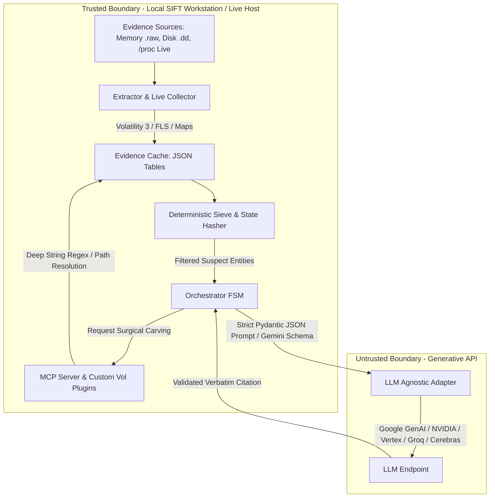

# Project Mantis: Autonomous DFIR Framework

[](https://github.com/codebyangelo/project-mantis/actions/workflows/test.yml)

Welcome to the Project Mantis repository. Project Mantis is an autonomous Digital Forensics and Incident Response (DFIR) framework designed to ingest raw memory and disk images, extract artifacts using SIFT Workstation tools and live `/proc` interfaces, and perform deterministic, hallucination-free triage using an LLM Agnostic Provider architecture.

> [!NOTE]
> **Hackathon Provenance & Historical Archive:**
> The original SIFT/SANS Hackathon submission (`v0.5.2`) and all iterative hackathon prototypes (`v0.0.1` through `v0.5.1`) are permanently preserved in Git history and archived on branch [`archive/hackathon-v0.5.2`](https://github.com/codebyangelo/project-mantis/tree/archive/hackathon-v0.5.2) and Git tag [`hackathon-archive-v0.5.2`](https://github.com/codebyangelo/project-mantis/releases/tag/hackathon-archive-v0.5.2).
> 
> The `main` branch contains the production-grade package (`src/mantis/`) with dual-OS (Linux & Windows) memory triage, surgical Volatility carving, and live system extraction.

---

## Architecture Diagram

The following Mermaid diagram illustrates how the components of Mantis interact, including the trust boundaries between deterministic extraction and the Generative AI orchestration:



For the comprehensive system specification, see [`docs/ARCHITECTURE.md`](docs/ARCHITECTURE.md) and individual module deep-dives in [`docs/subsystems/`](docs/subsystems/).

---

## Installation & Setup

### 1. Requirements
* Linux (SIFT Workstation, Ubuntu 22.04+, or Termux/Android Linux)
* Python 3.10+
* Volatility 3 and The Sleuth Kit (`fls`, `tsk_recover`) for offline forensic triage

### 2. Install Mantis
Install editable package directly via `pip`:
```bash
git clone https://github.com/codebyangelo/project-mantis.git
cd project-mantis
pip install -e .
```

### 3. Running Unit Tests
Execute the local regression and sieve unit test suite:
```bash
python3 -m unittest discover tests
```

---

## Repository Structure

```
project-mantis/
├── pyproject.toml              # Modern build system & CLI configuration
├── requirements.txt            # Locked dependencies
├── src/
│   └── mantis/                 # Core engine package
│       ├── __init__.py         # Package version (0.5.5)
│       ├── agent.py            # Gemini Structured Output & Provider Adapters
│       ├── baseline_engine.py  # RFC1918 & Known-Good Baseline Engine
│       ├── baseline_kb.json    # Baseline Knowledge Base
│       ├── config.py           # Runtime paths and dynamic OS detection
│       ├── dfir_playbook.json  # Windows DFIR State Machine Playbook
│       ├── dfir_playbook_linux.json # Linux DFIR State Machine Playbook
│       ├── extractor.py        # Volatility 3 Windows & Linux extractor
│       ├── live_collector.py   # Pure-Python live Linux artifact extractor
│       ├── logger.py           # Structured execution logger
│       ├── mantis_carve.py     # Custom Volatility 3 VAD surgical carving plugins
│       ├── mcp_server.py       # MCP Server & Surgical Carver
│       ├── orchestrator.py     # Orchestrator FSM loop with SHA-256 state hashing
│       ├── sieve.py            # Deterministic Windows & Linux sieve
│       └── sieve_deterministic.py # JIT/CFG memory allocator classifier
├── tests/                      # Unit and regression test suites
│   ├── test_sieve.py           # Sieve memory allocation test
│   └── test_mock_playbook.py   # Playbook mock run test harness
├── docs/                       # Architectural documentation
│   ├── ARCHITECTURE.md         # System Architecture & Subsystem Specification
│   ├── subsystems/             # Subsystem technical documentation
│   └── assets/                 # Architecture diagrams and figures
└── .github/workflows/          # Continuous integration workflows
```

---

## License

Apache-2.0 License. See [LICENSE](LICENSE) for details.
