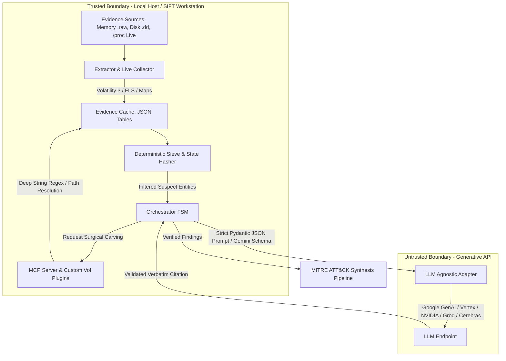

# Project Mantis: Autonomous DFIR Framework

[](https://github.com/codebyangelo/project-mantis/actions/workflows/test.yml)

Project Mantis is an autonomous Digital Forensics and Incident Response (DFIR) framework designed to ingest raw memory and disk images, extract artifacts using SIFT Workstation tools and live `/proc` interfaces, and perform deterministic, hallucination-free triage using an LLM Agnostic Provider architecture.

> [!NOTE]
> **Hackathon Provenance & Historical Archive:**
> The original SIFT/SANS Hackathon submission (`v0.5.2`) and all iterative hackathon prototypes (`v0.0.1` through `v0.5.1`) are permanently preserved in Git history and archived on branch [`archive/hackathon-v0.5.2`](https://github.com/codebyangelo/project-mantis/tree/archive/hackathon-v0.5.2) and Git tag [`hackathon-archive-v0.5.2`](https://github.com/codebyangelo/project-mantis/releases/tag/hackathon-archive-v0.5.2).
> 
> The `main` branch contains the production package (`src/mantis/`) with dual-OS (Linux & Windows) memory triage, surgical Volatility 3 plugins, and live system monitoring.

---

## 🏛️ System Architecture

Mantis enforces a hard trust boundary between local deterministic extraction and external generative inference:



Detailed architectural specifications are located in [`docs/ARCHITECTURE.md`](docs/ARCHITECTURE.md) and module documentation in [`docs/subsystems/`](docs/subsystems/).

---

## ⚙️ Core Architectural Invariants

1. **The Citation Trap (Hard Grounding Layer):**
   To eliminate hallucinated evidence, Mantis forces all LLM providers through strict Pydantic schemas requiring character-for-character verbatim telemetry quotes (`exact_telemetry_quote`). The orchestrator programmatically verifies quotes against raw evidence cache files (`verify_grounding`). Any claim failing exact substring verification is automatically tagged `GROUNDING_VIOLATION` and downgraded.
2. **Deterministic Pre-Filtering (Assembly & Path Sieve):**
   Before consuming LLM API calls, memory allocations and process structures pass through zero-latency local regex and assembly trampolines (`sieve_deterministic.py`). Redirections (`movabs rax, <addr>; jmp rax`), ROP stubs (`push <addr>; ret`), and known JIT engine protections are classified in 0ms locally.
3. **State Hashing & Deduplication:**
   Candidate entities are fingerprinted via deterministic SHA-256 hashes (`get_state_hash`) covering stable telemetry fields. Unchanged entities across sliding inspection windows bypass redundant LLM re-evaluations.
4. **Presumption of Benignity (Baseline Subtraction):**
   Ingests [`baseline_kb.json`](src/mantis/baseline_kb.json) to suppress false positives on known-good administrative binaries (`svchost.exe`, `sshd`, `systemd`) and RFC1918 internal subnets, reserving LLM budget for genuinely anomalous telemetry.
5. **In-Engine Surgical Memory Carving:**
   Provides custom Volatility 3 plugins ([`MantisLinuxCarve`](src/mantis/mantis_carve.py) and [`MantisWindowsCarve`](src/mantis/mantis_carve.py)) that execute targeted regex sweeps inside target PID VAD allocations directly within Volatility address spaces.

---

## 🚀 Installation & Setup

### 1. Prerequisites
* **OS:** Linux (SIFT Workstation, Ubuntu 22.04+, or Termux/Android Linux)
* **Python:** Python 3.10+
* **Forensic Toolchains (Offline Mode):** Volatility 3 and The Sleuth Kit (`fls`, `icat`)

### 2. Install Package
Install in editable mode:
```bash
git clone https://github.com/codebyangelo/project-mantis.git
cd project-mantis
pip install -e .
```

### 3. Verification Suite
Run the unit test suite:
```bash
python3 -m unittest discover tests
```

---

## 💻 CLI & Operation Modes

Mantis provides the `mantis` command-line executable (or `python3 -m mantis.orchestrator`):

### 1. Offline Forensic Triage (Memory & Disk Images)
Place evidence files in `PM_EVIDENCE_DIR` (or specify via environment variable).

```bash
# Standard exhaustive triage across memory and disk images
mantis

# Deep triage mode (enables EVTX, Registry hives, Prefetch, and LNK extraction)
mantis --deep
```

### 2. Live Linux System Monitoring (`--live`)
Directly ingests live host telemetry via `/proc`, `/proc/net/tcp`, and memory mappings without requiring external debuggers:

```bash
# Continuous live host monitoring with 30-second sliding inspection windows
mantis --live --interval 30
```

### 3. Standalone Extractor Execution
Run the Volatility 3 and SleuthKit extraction pipeline independently:

```bash
# Extract memory and disk artifacts into cache
python3 -m mantis.extractor

# Selective extraction
python3 -m mantis.extractor --memory
python3 -m mantis.extractor --disk --registry
```

### 4. Running the Model Context Protocol (MCP) Server
Launch the built-in forensic FastMCP server for integration with external LLM clients (e.g. Claude Desktop):

```bash
python3 -m mantis.mcp_server
```

---

## 🔧 Environment Configuration

All runtime configurations are managed via environment variables:

| Variable | Default | Description |
| :--- | :--- | :--- |
| `PM_EVIDENCE_DIR` | `/sdcard/Download/evidence` | Directory containing raw disk (`.dd`, `.raw`) and memory images. |
| `PM_CACHE_DIR` | `$PM_EVIDENCE_DIR/evidence_cache` | Output path for normalized forensic JSON tables. |
| `PM_LLM_PROVIDER` | `gemini_free` | Inference adapter: `gemini_free`, `vertex`, `nvidia`, `groq`, `cerebras`, or `mock`. |
| `PM_PLAYBOOK_PATH` | Dynamic | Path to DFIR playbook (auto-selects Linux vs Windows playbook). |
| `GEMINI_API_KEY` | None | API key for Google GenAI / Gemini Free endpoints. |
| `VERTEX_PROJECT_ID`| None | Google Cloud Project ID for enterprise Vertex AI inference. |
| `VERTEX_LOCATION`  | `us-central1` | Regional location for Vertex AI endpoint. |
| `NVIDIA_API_KEY`   | None | API key for NVIDIA NIM inference adapter. |
| `GROQ_API_KEY`     | None | API key for Groq fast LPU inference. |
| `CEREBRAS_API_KEY` | None | API key for Cerebras inference adapter. |

---

## 📂 Repository Structure

```
project-mantis/
├── pyproject.toml              # Modern build system & CLI configuration
├── requirements.txt            # Locked dependencies
├── src/
│   └── mantis/                 # Core engine package
│       ├── __init__.py         # Package version (0.5.5)
│       ├── agent.py            # Gemini Structured Output & Provider Adapters
│       ├── baseline_engine.py  # RFC1918 & Known-Good Baseline Engine
│       ├── baseline_kb.json    # Baseline Knowledge Base
│       ├── config.py           # Runtime paths and dynamic OS detection
│       ├── dfir_playbook.json  # Windows DFIR State Machine Playbook
│       ├── dfir_playbook_linux.json # Linux DFIR State Machine Playbook
│       ├── extractor.py        # Volatility 3 Windows & Linux extractor
│       ├── live_collector.py   # Pure-Python live Linux artifact extractor
│       ├── logger.py           # Structured execution logger
│       ├── mantis_carve.py     # Custom Volatility 3 VAD surgical carving plugins
│       ├── mcp_server.py       # FastMCP Server & Surgical Carver
│       ├── orchestrator.py     # Orchestrator FSM loop with SHA-256 state hashing
│       ├── sieve.py            # Deterministic Windows & Linux sieve
│       └── sieve_deterministic.py # JIT/CFG memory allocator classifier
├── tests/                      # Unit and regression test suites
│   ├── test_sieve.py           # Sieve memory allocation unit test
│   ├── test_mock_playbook.py   # Playbook mock run test harness
│   └── allocate_rwx.py         # Memory allocation test fixture
├── docs/                       # Architectural documentation
│   ├── ARCHITECTURE.md         # Comprehensive System Architecture & Specification
│   ├── subsystems/             # Subsystem technical documentation
│   └── assets/                 # Architecture diagrams and figures
└── .github/workflows/          # Continuous integration workflows
    └── test.yml                # Automated test runner
```

---

## 🔬 Evidence Datasets

During development and validation, Project Mantis was benchmarked against publicly available DFIR challenge datasets:

1. **CFReDS Data Leakage Case:** NIST exfiltration and insider threat forensic dataset ([NIST CFReDS](https://cfreds.nist.gov/all/NIST/DataLeakageCase)).
2. **ROCBA Ransomware Case:** SANS ransomware dataset covering process hollowing and registry persistence ([SANS Case File](https://sansorg.egnyte.com/fl/HhH7crTYT4JK#folder-link/HACKATHON-2026/Standard%20Forensic%20Case)).

---

## 📜 License

Apache-2.0 License. See [LICENSE](LICENSE) for details.
