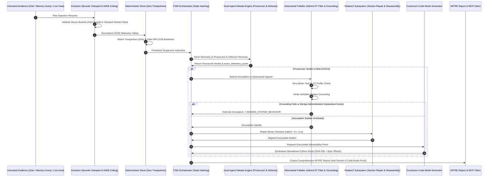

# Project Mantis: System Architecture & Subsystem Specification

## 1. Overview & Architectural Philosophy

Project Mantis is an autonomous, fail-closed Digital Forensics and Incident Response (DFIR) framework designed around six core architectural principles:
1. **Zero-Trust Evidence Ingestion**: Forensic memory dumps and disk images are treated as untrusted, potentially hostile inputs. All seeks, partition boundaries, and buffer streams are validated fail-closed.
2. **Mountless Telemetry Extraction**: Access disk partition structures without kernel block device mounting (`mount -o loop`) by combining The Sleuth Kit (`fls`/`icat`) with sector bounds checking.
3. **Layered Zero-Cost Sifting**: Suppress administrative and JIT false positives locally using 0ms deterministic heuristics before consuming generative LLM API calls or tokens.
4. **Adversarial Falsification & Challenger Inquest**: Subject every accusation of malicious activity to an adversarial inquiry that actively attempts to disprove the finding with contradictory evidence.
5. **Hard Citation Grounding**: Reject unverified LLM assertions by enforcing character-for-character verbatim quote checks (`verify_grounding`) against raw evidence cache files.
6. **Courtroom Admissibility (Code-Mode)**: Accompany every forensic finding with an autonomous, standalone, executable Python script verifying SHA-256 evidence hashes and raw offsets.

---

## 2. Detailed Subsystem Breakdown

### 2.1 Subsystem 1: Evidence Extractor (`extractor.py`)
- **Primary Modules**: `validate_sector_bounds`, `ClampedStreamReader`, `invalidate_evidence_cache`, `classify_image`
- **Disk Analysis**: Calls SleuthKit `fls -r -p` to map partition tables and inodes. Extracts raw files using `icat -r` without mounting partitions.
- **Fail-Closed Sector Clamping (radare2 PR #26606 precedent)**:
  `validate_sector_bounds()` mathematically verifies that sector offsets and extents reside within the physical image size prior to issuing disk commands, throwing `MantisOutOfBoundsPartitionError` fail-closed if bounds are breached.
- **64KB Heap Ceiling (radare2 Issue #12924 precedent)**:
  `ClampedStreamReader` enforces a hard chunk limit of 64KB (`MAX_CHUNK_SIZE = 65536`), preventing memory exhaustion when reading oversized or malformed forensic streams.
- **Cache Poisoning Prevention**:
  `invalidate_evidence_cache()` flushes destination cache files immediately upon read errors or unexpected exceptions, preventing downstream analysis of corrupted partial artifacts.

### 2.2 Subsystem 2: Deterministic Assembly Sieve (`sieve_deterministic.py`)
- **Primary Classes**: `MalfindClassifier`, `MalfindAllocation`, `ProcessVerdict`, `AllocationType`
- **Target Patterns**:
  - `TRAMPOLINE`: `movabs rax, <addr>; jmp rax` (Arbitrary memory redirection)
  - `ROP_STUB`: `push <addr>; ret` (Return-Oriented Programming stubs)
  - `JIT_PADDING`: `jmp <addr>; add byte ptr [rax], al` (Legitimate runtime JIT structures)
  - `CFG`: `movabs rax, <addr>; sub rcx, rax` (Control Flow Guard verification)
  - `DEFENDER_EMULATION`: `jmp rdx; int3` (Microsoft Defender emulation hooks)
- **Latency**: 0ms local execution, eliminating LLM API costs for common assembly patterns.

### 2.3 Subsystem 3: Heuristic Triage Engine (`sieve.py`)
- **Primary Class**: `HeuristicSieve`
- **Priority Scoring Algorithm**: Computes risk scores based on process path drop zones (`/tmp`, `/dev/shm`, `AppData\Local\Temp`), file extensions (`.elf`, `.bin`, `.sh`, `.ps1`), anomalous parent-child relationships, and network socket bindings.
- **Risk Classes**: `CRITICAL` (>80), `HIGH` (60-79), `MEDIUM` (40-59), `LOW` (<40).

### 2.4 Subsystem 4: Baseline Engine (`baseline_engine.py`)
- **Primary Class**: `BaselineEngine`
- **Database**: Ingests [`baseline_kb.json`](file:///root/home/projects/project-mantis/src/mantis/baseline_kb.json), containing verified signatures for standard OS utilities (`sshd`, `systemd`, `svchost.exe`, `explorer.exe`).
- **Function**: Automatically downgrades or suppresses alerts for known administrative processes with expected flags and checksums.

### 2.5 Subsystem 5: FSM Orchestrator (`orchestrator.py`)
- **Primary Class & Functions**: `run_fsm_loop()`, `generate_mitre_report()`, `get_state_hash()`
- **State Machine States**: `INIT` -> `EXTRACT` -> `SIEVE_FILTER` -> `PROSECUTOR_DEBATE` -> `ADVERSARIAL_FALSIFY` -> `GROUND_VERIFY` -> `CODE_MODE_SYNTHESIS` -> `REPORT_GENERATE`.
- **State Hashing & Sliding Windows**: Computes deterministic SHA-256 hashes of candidate entities, deduplicating unchanged processes across sliding inspection windows.

### 2.6 Subsystem 6: Dual-Agent Debate Engine (`agent.py`)
- **Primary Class**: `MantisAgent`
- **Prosecutor Persona**: Prompted to act as a hostile threat analyst identifying persistence, injection, and evasion mechanisms.
- **Defense Persona**: Prompted to act as a systems administrator seeking legitimate business justifications, update tasks, or benign system calls.
- **Synthesis**: Emits structured Pydantic models containing `verdict`, `confidence_score`, `exact_telemetry_quote`, and `mitre_tactics`.

### 2.7 Subsystem 7: Adversarial Falsifier (`falsifier.py`)
- **Primary Classes**: `AdversarialFalsifier`, `CounterHypothesis`
- **0ms Deterministic Refutation**:
  Matches candidate processes against known administrative tasks (`logrotate`, `cron`, `anacron`, `systemd-tmpfiles`) and benign JIT engines (`node`, `java`, `dotnet`, `v8`), overruling false positives in 0ms without external API calls.
- **Verbatim Citation Grounding Validator**:
  ```python
  def verify_grounding(self, evidence_text: str, citation: str) -> bool:
      return bool(citation and citation.strip() in evidence_text)
  ```
  Refutes LLM accusations that cite hallucinated IP addresses, hashes, or domain names not present in the raw telemetry.
- **Challenger Inquest**: Spawns an adversarial inquiry challenging the prosecution's claim and forcing judicial reconciliation.

### 2.8 Subsystem 8: Courtroom Code-Mode Engine (`courtroom.py`)
- **Primary Class**: `CourtroomScriptGenerator`
- **Autonomous Reproduction Scripts**:
  Generates standalone, executable Python scripts for every isolated threat. The script embeds:
  - Evidence file SHA-256 hash validation
  - Exact file seek offsets and read lengths
  - Byte-level expected header matching
  - Deterministic forensic exit codes:
    * `0`: Finding verified byte-exact.
    * `1`: Evidence file missing.
    * `2`: Evidence hash mismatch (tampered evidence).
    * `3`: Byte pattern mismatch.
- **Section 8 Synthesis**: Appends complete standalone reproduction code blocks into generated MITRE incident markdown reports.

### 2.9 Subsystem 9: Radare2 Reverse-Engineering Subsystem (`r2/`)
- **Primary Classes**: `R2Wrapper`, `R2BinaryInfo`, `R2Section`, `R2Opcode`, `reconstruct_dumped_pe`
- **Linker Isolation**: Solves host dynamic loader conflicts by symlinking candidate `libr_*.so` libraries into `~/.cache/mantis/r2_libs`, preventing foreign Android Termux runtime libraries from poisoning glibc.
- **Binary Section Repair (radare2 Issue #15449)**:
  `reconstruct_dumped_pe` executes `rabin2 -O r -O p` to re-align virtual sections and patch permissions on raw memory dump slices.

### 2.10 Subsystem 10: Model Context Protocol (MCP) Subsystem (`mcp/`)
- **Primary Classes**: `MCPServer`, `dispatch_tool`, `MCP_TOOLS`
- **Transport**: Native stdio JSON-RPC 2.0 protocol conforming to the Model Context Protocol specification (`initialize`, `tools/list`, `tools/call`, `ping`).
- **Exposed Typed Tools**:
  1. `mantis_r2_disasm(path, offset, count)`
  2. `mantis_r2_entropy(path, block_size)`
  3. `mantis_rabin_sections(path)`
  4. `mantis_rabin_info(path)`
  5. `mantis_reconstruct_pe(dump_path, output_path)`
  6. `mantis_get_evidence_context()`
  7. `mantis_query_cache(cache_name, keyword)`
  8. `mantis_search_timeline(keyword)`
  9. `mantis_carve_strings(regex_pattern, memory_image_path, pid)`

### 2.11 Subsystem 11: Unified CLI Interface (`cli.py`)
- **Entrypoint**: `mantis = "mantis.cli:main"`
- **Subcommands**:
  - `mantis triage`: Offline disk/memory triage and live host telemetry monitoring (`--deep`, `--live`, `--interval`).
  - `mantis carve`: Targeted evidence carving (`--memory`, `--disk`, `--registry`, `--evtx`, `--pcap`).
  - `mantis analyze-dump`: Standalone memory dump analysis with assembly classification and refutation (`--json`).
  - `mantis mcp`: Launches the stdio Model Context Protocol server.
- **Backward Compatibility**: Automatically routes legacy top-level flags (`mantis --deep`, `mantis --live`) to `triage`.

### 2.12 Subsystem 12: Domain Exception Hierarchy (`exceptions.py`)
- **Primary Classes**: `MantisError`, `MantisBoundaryError`, `MantisOutOfBoundsPartitionError`, `MantisTruncatedBlockError`, `MantisR2Error`, `MantisReconstructionError`
- **Behavior**: Ensures fail-closed error propagation across memory and disk boundaries.

### 2.13 Subsystem 13: Live Host Collector (`live_collector.py`)
- Ingests real-time host telemetry via `/proc`, `/proc/net/tcp`, `/proc/[pid]/maps`, and process environment descriptors without requiring external debuggers.

---

## 3. End-to-End Forensic Data Flow Diagram


