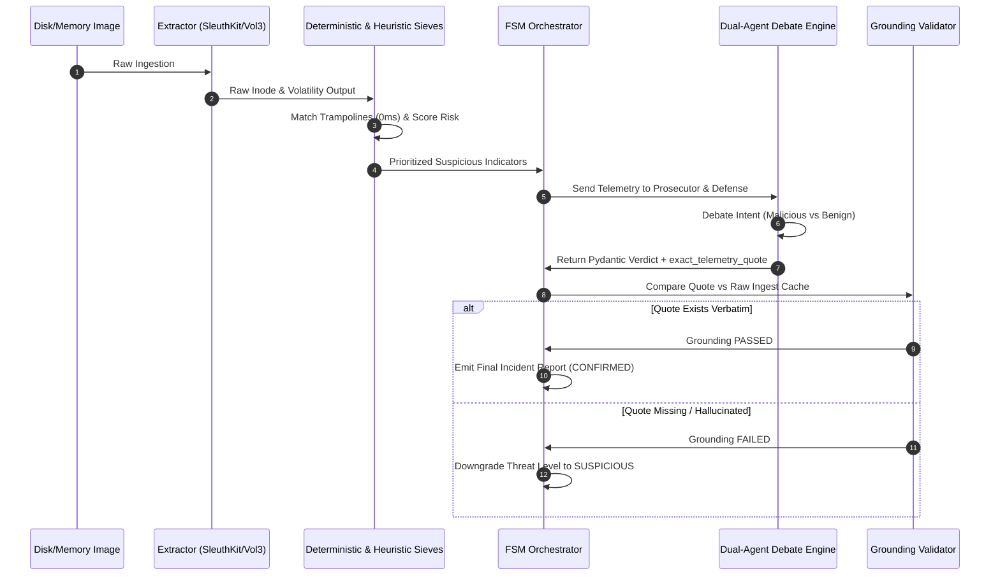

# Project Mantis: System Architecture & Subsystem Specification

## 1. Overview & Architectural Philosophy

Project Mantis is designed around four core architectural principles:
1. **Zero-Trust Evidence Ingestion**: Never trust LLM outputs unless they are backed by verbatim telemetry quotes.
2. **Mountless Telemetry Extraction**: Access disk partition structures without kernel block device mounting (`mount -o loop`).
3. **Layered Triage Pipeline**: Filter noise using zero-cost deterministic regular expressions before passing prioritized anomalies to cloud LLMs.
4. **Adversarial Persona Consensus**: Reduce false positives by requiring a Prosecutor agent and a Defense agent to debate forensic evidence.

---

## 2. Detailed Subsystem Breakdown

### 2.1 Subsystem 1: Evidence Extractor (`extractor.py`)
- **Primary Class**: `ForensicExtractor`
- **Disk Analysis**: Calls SleuthKit `fls -r -p` to map partition tables and inodes. Extracts raw files using `icat -r` without mounting partitions.
- **Memory Analysis**: Invokes Volatility 3 plugins (`pslist`, `pstree`, `netscan`, `malfind`, `dlllist`, `cmdline`).
- **String Carving**: Runs binary and UTF-16 streaming carvers (`strings -a -e l`) to extract strings from unallocated memory blocks.

### 2.2 Subsystem 2: Deterministic Assembly Sieve (`sieve_deterministic.py`)
- **Primary Function**: `analyze_assembly_trampoline(assembly_code: str)`
- **Target Patterns**:
  - `movabs rax, <addr>; jmp rax` (Standard shellcode / JIT redirection)
  - `push <addr>; ret` (Return-Oriented Programming ROP stubs)
  - Windows Defender / AV JIT hooks in memory allocations.
- **Latency**: 0ms local execution, bypassing LLM API calls entirely for common patterns.

### 2.3 Subsystem 3: Heuristic Triage Engine (`sieve.py`)
- **Primary Class**: `HeuristicSieve`
- **Priority Scoring Algorithm**: Computes risk scores based on process path locations (e.g., `/tmp`, `/dev/shm`, `AppData\Local\Temp`), file extensions (`.elf`, `.bin`, `.sh`, `.ps1`), anomalous parent-child relationships, and network socket bindings.
- **Risk Classes**: `CRITICAL` (>80), `HIGH` (60-79), `MEDIUM` (40-59), `LOW` (<40).

### 2.4 Subsystem 4: Baseline Engine (`baseline_engine.py`)
- **Primary Class**: `BaselineEngine`
- **Database**: Ingests [`baseline_kb.json`](file:///root/home/projects/github-projects-for-docs/project-mantis-full/agent_v0.5.2_stable-hackathon/baseline_kb.json), containing signatures for standard OS utilities (`sshd`, `systemd`, `svchost.exe`, `explorer.exe`).
- **Function**: Automatically downgrades or suppresses alerts for known administrative processes with expected flags and checksums.

### 2.5 Subsystem 5: FSM Orchestrator (`orchestrator.py`)
- **Primary Class**: `DFIROrchestrator`
- **State Machine States**: `INIT` -> `EXTRACT` -> `SIEVE_FILTER` -> `DEBATE_CYCLE` -> `GROUND_VERIFY` -> `REPORT_GENERATE`.
- **Hard Grounding Enforcement**:
  ```python
  def verify_grounding(telemetry_raw: str, exact_quote: str) -> bool:
      return exact_quote in telemetry_raw
  ```
  If `verify_grounding` returns `False`, the threat level is downgraded to `SUSPICIOUS` with a `GROUNDING_VIOLATION` tag.

### 2.6 Subsystem 6: Dual-Agent Debate Engine (`agent.py`)
- **Primary Class**: `DebateAgent`
- **Prosecutor Persona**: Prompted to act as a hostile threat analyst looking for indicators of compromise (IOCs), evasion techniques, and persistence mechanism.
- **Defense Persona**: Prompted to act as a system administrator searching for legitimate business justifications, software updater behavior, or benign system calls.
- **Synthesis**: Combines both arguments into a final Pydantic JSON structure containing `verdict`, `confidence_score`, `exact_telemetry_quote`, and `mitre_tactics`.

### 2.7 Subsystem 7: Model Context Protocol (MCP) Server (`mcp_server.py`)
- **Protocol**: Standard MCP Stdio JSON-RPC.
- **Exposed Tools**:
  - `extract_partition_tree(disk_path)`
  - `carve_inode_file(disk_path, inode)`
  - `run_volatility_plugin(memory_path, plugin_name)`
  - `triage_process_tree(process_json)`
  - `evaluate_grounded_verdict(telemetry_quote)`

---

## 3. Data Flow Diagram


