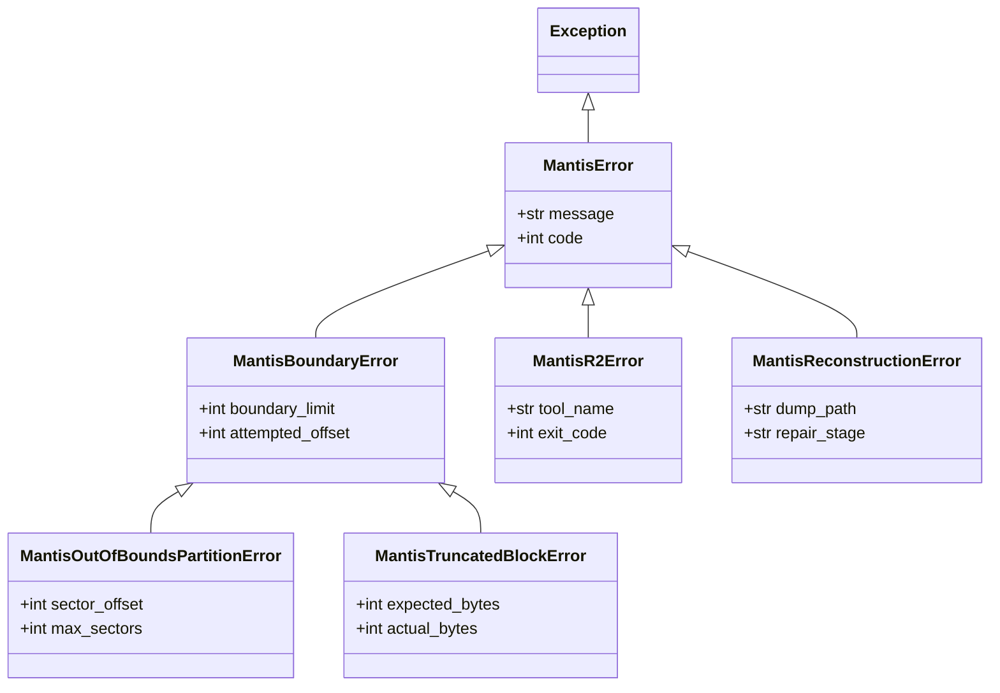

# Documentation: `exceptions.py`

## Overview

The `exceptions.py` module defines the **fail-closed domain exception hierarchy** for Project Mantis. Forensic data extraction and binary reverse-engineering frequently process corrupt, truncated, or deliberately weaponized inputs. To prevent silent failures, corrupted cache states, or unbounded loops, Mantis enforces strict typed exception propagation across all extraction and analysis boundaries.

---

## Architectural Hierarchy

---

## Component Details

### 1. Root Exception: `MantisError`
* **Base**: Inherits from standard Python `Exception`.
* **Attributes**:
  - `message` (`str`): Detailed technical description of the failure mode.
  - `code` (`int`, default `1`): Standard process exit code associated with the error.

### 2. Boundary Exceptions
* **`MantisBoundaryError`**: Base class for memory and disk boundary violations.
* **`MantisOutOfBoundsPartitionError`**:
  - **Trigger**: Raised by `validate_sector_bounds()` when a requested partition sector offset or extent exceeds the physical image size.
  - **Behavior**: Halts extraction immediately and triggers cache invalidation to prevent corrupted partition analysis.
* **`MantisTruncatedBlockError`**:
  - **Trigger**: Raised by `ClampedStreamReader` when a stream read encounters unexpected EOF or truncated data blocks.

### 3. Tool & Reverse-Engineering Exceptions
* **`MantisR2Error`**:
  - **Trigger**: Raised by `R2Wrapper` when `radare2`, `rabin2`, or `rahash2` encounters a non-zero exit code, command timeout, or missing executable.
* **`MantisReconstructionError`**:
  - **Trigger**: Raised by `reconstruct_dumped_pe()` if section repair fails or if the output artifact lacks valid executable magic headers (`MZ` or `\x7fELF`).

---

## Standardized Return Codes

The module exports standard return code constants:
* `MANTIS_RC_SUCCESS = 0`: Clean execution.
* `MANTIS_RC_FAILURE = 1`: General execution failure or missing tool.
* `MANTIS_RC_CORRUPTED = 2`: Damaged partition table or invalid magic bytes.
* `MANTIS_RC_TIMEOUT = 124`: Subprocess exceeded bounded timeout threshold.
