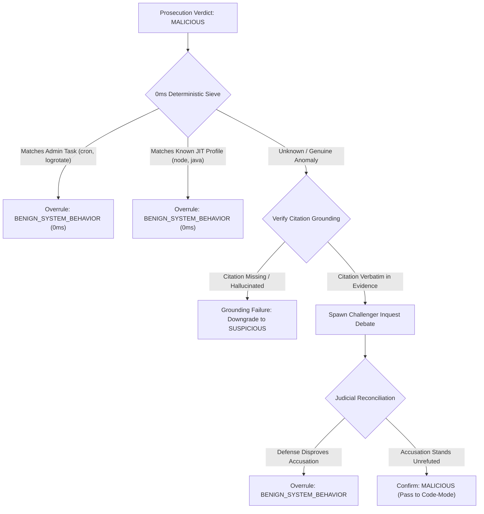

# Documentation: `falsifier.py`

## Overview

The `falsifier.py` module implements the **Adversarial Falsification & Challenger Inquest Engine** for Project Mantis. Inspired by the architectural insight of the SANS Find Evil competition winner (Mulder), this module forces the triage loop to actively seek disproof of any prosecution claim before an entity is branded malicious. By combining **0ms deterministic administrative filters** with **verbatim citation grounding validation**, it eliminates false positives on routine maintenance tasks and prevents hallucinated IOCs from entering incident reports.

---

## Architectural Breakdown

### Dependencies
- **Standard Library**: `dataclasses`, `re`, `typing`
- **Internal Modules**:
  - `logger.ExecutionLogger`: Audit trail logging.

---

## Component Details

### 1. `CounterHypothesis` Data Structure
A pure-Python dataclass representing the alternative benign explanation:
* `target_entity` (`str`): Label or PID of the accused entity.
* `alternative_explanation` (`str`): Plausible benign hypothesis explaining the observed behavior.
* `refuting_evidence` (`str`): Specific telemetry supporting the alternative explanation.
* `recommended_verdict` (`str`): Recommended new classification (default `"BENIGN_SYSTEM_BEHAVIOR"`).
* `confidence` (`float`): Confidence score of the counter-hypothesis (0.0 to 1.0).
* `is_refuted` (`bool`): Flag indicating whether the malicious accusation has been overturned.

### 2. `AdversarialFalsifier` Engine

#### `check_deterministic_falsification(entity_label: str, entity_evidence: str) -> CounterHypothesis | None`
- **Purpose**: Evaluates candidate processes against compiled regex profiles in 0ms locally without calling external LLM APIs.
- **Vectors Checked**:
  - **Administrative Tasks**: Detects `logrotate`, `cron`, `anacron`, and `systemd-tmpfiles`.
  - **Legitimate JIT Engines**: Detects runtime memory allocation profiles for Node.js (`node`), Java Virtual Machine (`java`), .NET Core (`dotnet`), and V8 (`v8_context`).
- **Return**: A `CounterHypothesis` with `is_refuted=True` if matched; `None` if the behavior remains unclassified.

#### `verify_grounding(evidence_text: str, citation: str) -> bool`
- **Purpose**: Verifies that any indicator, file path, IP address, or command string cited by an LLM exists character-for-character within the raw evidence dump.
- **Return**: `True` if citation is an exact substring of `evidence_text`; `False` if hallucinated or missing.

#### `generate_challenger_prompt(entity_label: str, prosecutor_claim: str, evidence_snippet: str) -> str`
- **Purpose**: Formulates an adversarial inquiry instructing the defense persona to search for authorized execution contexts, code signatures, or business justifications.

#### `reconcile_verdict(prosecutor_verdict: str, counter_hypothesis: CounterHypothesis | None) -> str`
- **Purpose**: Acts as the judicial synthesis authority. If the counter-hypothesis successfully refutes the accusation, the final classification is downgraded fail-closed to `BENIGN_SYSTEM_BEHAVIOR`.
